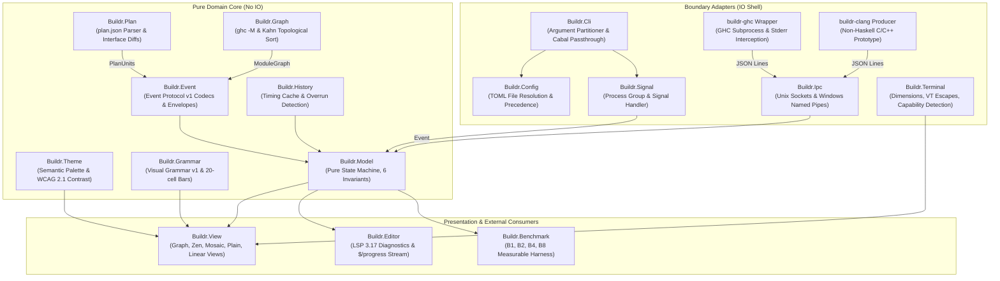
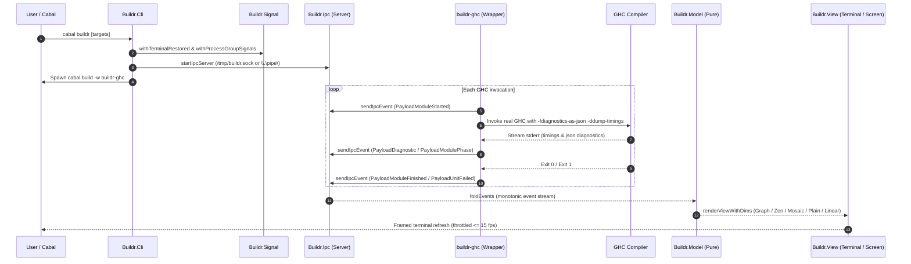

# buildr Architecture & Module Dependency Graph

This document provides a visual and structural blueprint of the **buildr** repository for AI agents and human contributors. It maps the module hierarchy, data pipelines, IPC streaming connections, and cross-cutting layers according to the [Haskell Engineering Standard](file:///Users/air/Documents/seby/projects/Haskell/buildr/ai/haskell-engineering-standard.md) (hexagonal architecture, acyclic dependencies pointing toward the pure core).

---

## 1. High-Level Architectural Pipeline

---

## 2. Component Breakdown & Module Roles

| Module | Architectural Layer | Responsibility | Pure? | Key Dependencies |
|---|---|---|---|---|
| [`Buildr.Core`](file:///Users/air/Documents/seby/projects/Haskell/buildr/src/Buildr/Core.hs) | Facade | Re-exports all core public modules and version identifiers | Pure | All `Buildr.*` |
| [`Buildr.Error`](file:///Users/air/Documents/seby/projects/Haskell/buildr/src/Buildr/Error.hs) | Domain Types | Closed sum types for all pipeline failure modes | Pure | None |
| [`Buildr.Event`](file:///Users/air/Documents/seby/projects/Haskell/buildr/src/Buildr/Event.hs) | Core IR | Event Protocol v1 envelope, payload sum types, JSON Lines codecs | Pure | `Buildr.Error` |
| [`Buildr.Grammar`](file:///Users/air/Documents/seby/projects/Haskell/buildr/src/Buildr/Grammar.hs) | Core IR | Visual Grammar v1 states, glyphs, 20-cell progress bar geometry | Pure | None |
| [`Buildr.Model`](file:///Users/air/Documents/seby/projects/Haskell/buildr/src/Buildr/Model.hs) | Domain Core | Pure state fold: `Event -> BuildModel -> BuildModel` | Pure | `Buildr.Event`, `Buildr.Grammar` |
| [`Buildr.Plan`](file:///Users/air/Documents/seby/projects/Haskell/buildr/src/Buildr/Plan.hs) | Adapter / Core | Parses `plan.json`, interface diffs (`-ddump-hi-diffs`) | Pure IO Edge | `Buildr.Error`, `Buildr.Event` |
| [`Buildr.Graph`](file:///Users/air/Documents/seby/projects/Haskell/buildr/src/Buildr/Graph.hs) | Domain Core | Dependency graph parsing (`ghc -M`) and Kahn's algorithm | Pure IO Edge | `Buildr.Event` |
| [`Buildr.History`](file:///Users/air/Documents/seby/projects/Haskell/buildr/src/Buildr/History.hs) | Domain Core | Statistical median compilation duration and overrun alerts | Pure IO Edge | `Buildr.Error` |
| [`Buildr.Theme`](file:///Users/air/Documents/seby/projects/Haskell/buildr/src/Buildr/Theme.hs) | Core IR | Rasika color palette and WCAG 2.1 4.5:1 contrast verification | Pure | None |
| [`Buildr.Hinsight`](file:///Users/air/Documents/seby/projects/Haskell/buildr/src/Buildr/Hinsight.hs) | Adapter | GHC version match gate and typed-hole explanations | IO Shell | `Buildr.Event` |
| [`Buildr.Terminal`](file:///Users/air/Documents/seby/projects/Haskell/buildr/src/Buildr/Terminal.hs) | Adapter | Dynamic dimensions, VT sequences (OSC 8, undercurl, OSC 9;4) | IO Shell | `Buildr.Grammar`, `Buildr.Event` |
| [`Buildr.View`](file:///Users/air/Documents/seby/projects/Haskell/buildr/src/Buildr/View.hs) | Presentation | Pure renderers for Graph, Zen, Mosaic, Plain, and Linear views | Pure | `Buildr.Model`, `Buildr.Terminal`, `Buildr.Theme` |
| [`Buildr.Config`](file:///Users/air/Documents/seby/projects/Haskell/buildr/src/Buildr/Config.hs) | Adapter | TOML configuration resolution and precedence merging | IO Shell | `Buildr.Error`, `Buildr.View` |
| [`Buildr.Signal`](file:///Users/air/Documents/seby/projects/Haskell/buildr/src/Buildr/Signal.hs) | Adapter | Process group signal propagation, terminal attribute restoration | IO Shell | `Buildr.Model`, `Buildr.View` |
| [`Buildr.Ipc`](file:///Users/air/Documents/seby/projects/Haskell/buildr/src/Buildr/Ipc.hs) | Adapter | Unix domain socket & Windows Named Pipe async streaming | IO Shell | `Buildr.Error`, `Buildr.Event` |
| [`Buildr.Cli`](file:///Users/air/Documents/seby/projects/Haskell/buildr/src/Buildr/Cli.hs) | Application | Argument partitioner and native `cabal buildr` entry point | IO Shell | All `Buildr.*` |
| [`Buildr.Editor`](file:///Users/air/Documents/seby/projects/Haskell/buildr/src/Buildr/Editor.hs) | Presentation | LSP 3.17 diagnostic conversion and `$/progress` stream | Pure | `Buildr.Event` |
| [`Buildr.Benchmark`](file:///Users/air/Documents/seby/projects/Haskell/buildr/src/Buildr/Benchmark.hs) | Verification | Automated benchmark harness for B1, B2, B4, B8 | IO Shell | `Buildr.Core`, `Buildr.Model`, `Buildr.Ipc` |

---

## 3. Detailed Data Flow Architecture

---

## 4. Invariant Boundaries & Dependency Rules

1. **Pure Core Dependency Rule**:
   * Modules in `Pure Domain Core` (`Model`, `Event`, `Grammar`, `Theme`) **NEVER** import from `Boundary Adapters` (`Ipc`, `Signal`, `Terminal`, `Config`, `Cli`).
   * No `IO` exists in `Buildr.Model`, `Buildr.Grammar`, `Buildr.Theme`, or `Buildr.Editor`.
2. **Error Sum Rule**:
   * Every failure constructor lives in [`Buildr.Error`](file:///Users/air/Documents/seby/projects/Haskell/buildr/src/Buildr/Error.hs). No strings or exceptions are propagated into the core domain.
3. **Totality Enforcement**:
   * Every function pattern matches exhaustively. Banned: `head`, `tail`, `fromJust`, `(!!)`, `error`, `undefined`.
